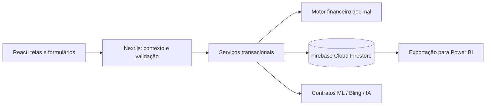

# Arquitetura e decisões

Next.js 16 App Router / React 19 / TypeScript. Rotas REST no runtime Node.js, validação Zod, cálculos com Decimal.js e Cloud Firestore por Firebase Admin no runtime Node. Dinheiro e percentuais são armazenados como texto decimal, evitando conversão financeira para ponto flutuante. Valores monetários exibidos são arredondados a centavos, percentuais têm até seis casas de entrada. Preços propostos e atuais usam centavos; descontos são arredondados ao preço de venda antes de calcular custos.

O banco foi alterado para Firebase a pedido do usuário. `server/db.ts` concentra configuração do Admin SDK, documentos, consultas e transações. Coleções mantêm as entidades e retratos históricos, com valores decimais e datas ISO. Propostas guardam a versão da oferta e a revisão dos parâmetros; alterar parâmetros invalida propostas sem regravar todas as ofertas. Firebase Authentication, Storage e Analytics permanecem fora do fluxo atual.

Não há autenticação própria. `server/access.ts` fornece o operador único da organização DATAMAT e suas lojas ativas. Não aceita identidade, papel ou organização do navegador. A futura identidade verificada do portal substituirá esse adaptador. Regras cliente negam leitura/escrita direta. Firebase Admin usa IAM; verificações de organização, loja e papel permanecem nos serviços.

## Entidades e vínculos

- Organização tem lojas, produtos, marcas e categorias.
- Contexto de acesso tem organização, responsável, papel e lojas. Atualmente todos os acessos usam o operador único; o portal deverá fornecer identidade e escopo individuais. APIs não confiam no filtro visual.
- Produto tem marca/categoria/modelo e pode ter múltiplos anúncios, inclusive na mesma loja.
- Oferta tem loja, produto, título, SKU, código ML, tipo, situação, preço e procedência. Código ML é único somente dentro da loja. SKU não é uma identidade interna.
- Composição vincula oferta a produtos e quantidades/atributos. Mercadoria nos custos representa a oferta inteira, sem inferir custos unitários dos componentes.
- Custos pertencem à oferta; parâmetros à loja. Propriedades omitidas herdam; `null` significa desconhecido; `"0"` substitui explicitamente zero.
- Simulação armazena o cenário calculado. Proposta preserva um retrato separado e um fluxo de situação. Aprovações e aplicações têm registros próprios.
- Histórico retém valores, data, ator, origem, situação e snapshot JSON. Snapshots financeiros não são recalculados.
- Tarefa pertence à loja e pode ter oferta. Nota pode ser organizacional, da loja ou da oferta. Conversão em tarefa mantém `source_note_id` único.
- Conexão e log de sincronização permitem registrar operações e sua situação, sem inventar dados externos.

## Cálculo

Receita considerada = preço de venda + contribuição financeira ML. Custos fixos da oferta = mercadoria + cobrança fixa ML + envio + embalagem + publicidade + outros. Tarifa percentual usa o preço; impostos e comissão usam a base configurada: preço do comprador ou receita com contribuição ML.

Contribuição = receita − custos. Contribuição percentual = contribuição / receita. Não é lucro líquido. Preço mínimo estimado = custos fixos / (1 − taxas percentuais − margem mínima). O denominador deve ser positivo. O limite é conservador, desconsiderando subsídio promocional e assumindo custos constantes. Preço mínimo é arredondado para cima; desconto máximo é indisponível se o preço atual já estiver abaixo do mínimo. Tarifas e frete exigem revalidação.

Dados desconhecidos geram pendências; custos nulos nunca são presumidos iguais a zero. Parâmetros pendentes impedem apenas os resultados que deles dependem. Impostos e comissão exigem bases identificadas. Cálculos não inferem impacto em volume de vendas.

## Consistência e segurança

- Transações Firestore garantem operações atômicas e repetem conflitos. Escritas são preparadas em memória e enviadas depois de todas as leituras, conforme exigido pelo SDK. Não há efeitos externos dentro das transações.
- Documentos de reserva `unique_keys`, com IDs determinísticos, garantem unicidade de código ML por loja e conversão de nota. Relações e isolamento são validados pelo servidor; o Firestore não possui foreign keys.
- Request IDs e unicidade controlam reenvio de importações, propostas, etapas e sincronizações. Reutilizar uma chave com payload incompatível é rejeitado.
- Alterações de oferta/custos/parâmetros invalidam a revisão usada por propostas pendentes. Aplicação compara a versão.
- O formulário de proposta envia as versões exibidas no cálculo; salvar um cenário desatualizado é rejeitado. Custos, tarefas e notas também enviam versões para evitar sobrescrever edições concorrentes.
- Corrigir um produto compartilhado exige acesso a todas as lojas dos anúncios relacionados. A correção preserva sua identidade e atualiza a revisão desses anúncios em uma transação; acima de 75 anúncios relacionados, a operação exige tratamento em lote.
- Exclusão exige confirmação, versão atual e request ID. Tarefas e notas são removidas mantendo auditoria; uma nota convertida exige remover sua tarefa antes. Somente rascunhos ou referências sem tarefas, notas ou propostas podem ser excluídos. Custos, composição e simulações do anúncio são removidos, mas produto e histórico permanecem. Para anúncios em operação ou com decisões, use a situação Encerrado.
- Propostas ainda não aplicadas podem ser canceladas pelo autor ou por quem pode aprovar. O cancelamento preserva o retrato financeiro, registra justificativa e não altera o preço.
- Salvar proposta ou aprová-la não altera a oferta. Aplicar manualmente exige aprovação, solicitação, evidência, dados financeiros completos e tarifas/frete revalidados quando o preço muda.
- Mutações verificam a origem exata `APP_URL`. Sem login próprio, essa verificação não autentica pessoas; controle de acesso externo depende da integração com o portal.
- SDK com consultas estruturadas. Strings são escapadas pelo React; não há renderização HTML de descrições ou notas. CSV neutraliza fórmulas.
- Não existem cadastro inicial, senha padrão, cookie de sessão, login ou logout. Novos eventos guardam `actor_name`, preservando a identificação histórica mesmo após trocar o contexto de acesso.

Filtros de ofertas são aplicados no servidor e representados na URL. Marca/categoria disponíveis derivam da loja autorizada. Pesquisa cobre título, produto, SKU, modelo, marca e código ML. Retorno da ficha preserva consulta, ordenação e página. A troca de loja limpa seleções incompatíveis e avisa sobre edição não salva.

Datas de prazo permanecem datas de calendário; timestamps do histórico são exibidos e filtrados no fuso America/Sao_Paulo. Isso evita divergência entre o dia mostrado e o dia selecionado no filtro perto da meia-noite UTC.

## Pressupostos e limites

Primeira versão para uma organização operacional; servidores usam o mesmo projeto Firestore, com duas lojas iniciais. Lojas adicionais são criadas pela interface. Configuração de organizações adicionais e associação entre clientes exigem evolução administrativa. As listas têm rolagem limitada e paginação visual configurável de 20, 50 ou 100 registros; a consulta inicial ainda carrega os registros das lojas disponíveis. Em grande volume, implementar paginação por cursor e agregações Firestore. Não há cron ou escrita no ML/Bling. O endpoint de notificações recebe e deduplica sinais em uma caixa limitada, sem usar seus payloads como dados operacionais.

Excel/CSV validam até 1.000 linhas por arquivo de até 2 MB; cada confirmação grava até 40 linhas em uma transação. O diálogo conserva chaves e progresso para retomar após falha. Atualizações exigem ID/versão, mantêm custos e identidade do produto e bloqueiam mudanças de preço fora de propostas. O repositório limita cada transação a 450 documentos alterados, preservando margem em relação aos limites do serviço. Índices de campos JSON extensos e hashes de senha são desativados na configuração versionada. Consultas de listagem usam filtro por loja ou organização e ordenação em memória; volumes maiores exigem paginação no banco. Documentos legados de usuários permanecem para leitura histórica; não há criação ou uso de sessões.

## Leitura e renderização

A inicialização idempotente é memorizada por instância do servidor; falhas permitem nova tentativa. O cliente separa filtros que exigem consulta de estado de apresentação. Paginação, ordenação, abas e filtros locais de tarefas/histórico não recarregam o workspace. Abrir/fechar a ficha reutiliza o catálogo da consulta atual; alterações invalidam esse cache local. Não existe cache compartilhado de dados de outras organizações.

A paginação limita o DOM, não a leitura inicial do Firestore. Consulta por cursor, busca indexada e agregações continuam pendentes para bases extensas. Exportações incluem o conjunto filtrado completo. Esses limites são distintos e não devem ser apresentados como paginação de banco já implementada.

## Cenários e autocomplete

O navegador calcula a cada alteração com `domain/finance.ts`, sem requests ou gravações por tecla. O servidor usa o mesmo motor e recalcula a proposta com dados atuais, conferindo as versões exibidas. `costOverrides` contém um conjunto completo de custos previstos; taxas/bases opcionais ausentes significam herdar a loja, portanto o conjunto substitui os custos do cenário e não retém antigas substituições. A coluna atual usa os custos persistidos. Custos específicos de tarifa/frete/publicidade do input prevalecem sobre o conjunto previsto.

A ficha lê parâmetros e sua revisão do mesmo documento, evitando associar um cálculo a uma revisão de outra leitura. A confirmação de aplicação grava os custos previstos aprovados e valida pendências e revalidação de condições ML, inclusive quando tarifas/frete mudam sem mudar o preço. O desconto máximo é truncado para baixo a quatro casas e exibido nessa precisão.

Autocomplete usa texto existente no workspace, deduplicação sem distinguir caixa/acentos e até 25 sugestões por campo. O datalist nativo mantém entrada livre e teclado; não consulta API por tecla, não escolhe uma identidade de produto por SKU e não preenche custos por suposição. Descrições longas e dados financeiros não são preenchidos automaticamente.

## Mercado Livre e hospedagem

`server/mercadolivre.ts` implementa OAuth, tokens privados protegidos, refresh com lease, scan de catálogo com checkpoints e observações auditadas, consultas financeiras vinculadas ao cenário e métricas agregadas sem dados de compradores. Coleções servidor: `ml_tokens`, `ml_oauth_states`, `ml_sync_pages`, `ml_quotes`, `ml_metrics` e `ml_notification_inbox`. A projeção pública de conexão é explícita. Condições comerciais observadas alteram a versão da oferta mesmo se o preço não mudar; isso invalida decisões antigas. Consultas externas ficam fora das transações Firestore.

Na Vercel, Firebase Admin recebe JSON secreto por variável, sem depender do arquivo local. As APIs usam runtime Node.js e orçamento de execução para retomar lotes interrompidos. O contexto de operador único continua aguardando integração com o portal; não existe login próprio. Ver [Vercel](vercel.md) e [integrações](integrations.md).
